---

I design enterprise data platforms and the Agentic systems that run on top of them. Over 10+ years across telecom, IoT, agritech, retail and e-commerce, my work has centred on one problem: turning fragmented operational data into governed, reliable foundations that analytics and AI can be trusted on.

Currently at **Thoughtworks**, architecting data platforms for global retail and e-commerce clients. Based in Hyderabad / Bengaluru. Open to remote engagements and advisory work.

### Areas of Practice

| Domain | Scope |
|---|---|
| **Data Platform Architecture** | Lakehouse and warehouse design, batch + streaming ingestion, Data Vault modeling, cross-warehouse interoperability |
| **Production GenAI** | RAG architectures, agentic AI on governed data, retrieval and vector store design, LLM fine-tuning (LoRA / QLoRA) |
| **Data Quality & Governance** | Validation frameworks, contract-driven pipelines, observability across heterogeneous sources |
| **Cloud-Native Delivery** | Platform design on AWS, Azure and GCP; infrastructure as code; containerised workloads |

### Technology

| | |
|---|---|
| **Languages** |     |
| **Data Processing** |     |
| **Platforms** |     |
| **GenAI & ML** |     |
| **Cloud & Infra** | ![AWS](https://img.shields.io/badge/AWS-0d1117?style=flat-square&logo=) ![Azure](https://img.shields.io/badge/Azure-0d1117?style=flat-square&logo=)     |
| **Databases** |    ![Oracle](https://img.shields.io/badge/Oracle-0d1117?style=flat-square&logo=)  |

### Certifications

- Anthropic — Claude Certified Architect, Professional (2026)
- Anthropic — Claude Certified Architect, Foundations (2026)
- Google Cloud — Professional Data Engineer (2025)

### Writing

I write about data platform design and applied GenAI at [blog.harisankarsivankutty.in](https://blog.harisankarsivankutty.in/) and on [Medium](https://medium.com/@brainbytebyhari).

---

